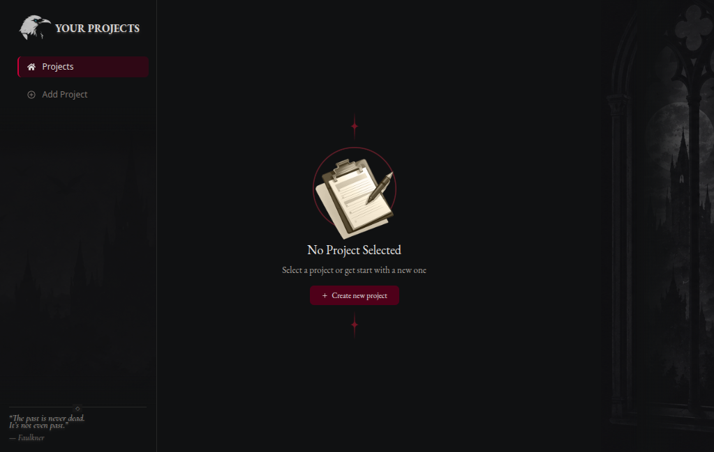

# Project Chronicle

A gothic-themed project planner built with React, TypeScript, Vite, and Tailwind CSS as a small front-end learning project.

> Project Chronicle is intentionally simple: it was made to practice React components, props, state, forms, and UI styling—not to be a production-ready task manager.

## Screenshot



## Features

- Create projects with a title, description, and due date.
- Browse projects in a responsive card layout and open their details.
- Add and clear tasks within a project.
- Delete a project and return to the project list.
- See a message dialog after project and task actions.
- Use a dark gothic-inspired interface with rose accents and glass-like project cards.

## How it works

The app has three views: the project list, the add-project form, and project details. The current view is selected using React state in the main component, with callbacks passed between components.

There is no routing library (such as React Router). For this small exercise, conditional rendering based on view state was sufficient. A router could be added later if the app needed URLs, browser history, or direct links to projects.

Projects and tasks are stored in React state in memory only. They are lost when the page is refreshed; there is no backend or browser persistence.

## Tech stack

- React
- TypeScript
- Vite
- Tailwind CSS
- React Icons
- Oxlint

## Run locally

Requirements: Node.js and npm.

```bash
npm install
npm run dev
```

Open the local URL printed by Vite in your browser.

| Command | Description |
| --- | --- |
| `npm run dev` | Start the development server. |
| `npm run build` | Type-check and create a production build in `dist/`. |
| `npm run preview` | Preview the production build locally. |
| `npm run lint` | Run Oxlint. |

## Fonts

The project includes font files from Google Fonts:

- [Cormorant Garamond — license information](https://fonts.google.com/specimen/Cormorant+Garamond/license?query=Cormorant+Garamond)
- [EB Garamond — license information](https://fonts.google.com/specimen/EB+Garamond/license?query=EB+Garamond)

The font files are located in `src/assets/font/`. Refer to the linked pages for the applicable license terms.

## Artwork

The artwork included with this practice project was generated using AI. The image files are stored under `src/assets/`.

## Current scope and limitations

- This is a learning project and intentionally avoids extra architecture for its small scope.
- Projects and tasks are not persisted between page refreshes.
- Navigation is view-state based; there are no separate routes or shareable project URLs.
- The Cancel button is not currently included in the add-project form.
- There is no backend, automated test suite, or production deployment setup.

## Suggested GitHub repository metadata

**About description:** A gothic-themed project planner built with React, TypeScript, Vite, and Tailwind CSS.

**Topics:** `react`, `typescript`, `vite`, `tailwindcss`, `project-planner`, `learning-project`
